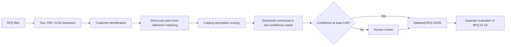
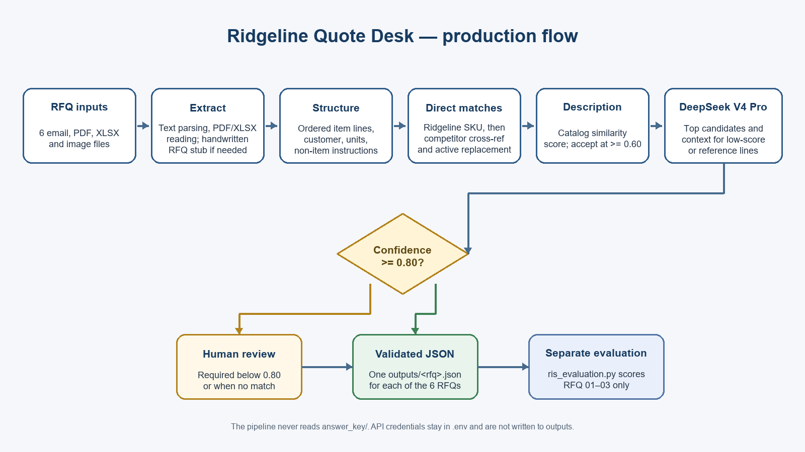

# Ridgeline Quote Desk

## Repository

Public repository: https://github.com/osamahabib5/ridgeline_industry_supplies_demo

## How to Run

From the repository root in Git Bash on Windows:

```bash
py -m venv .venv
source .venv/Scripts/activate
python -m pip install -r requirements.txt
[ -f .env ] || cp .env.example .env
```

Set `DEEPSEEK_API_KEY` in `.env`, then run:

```bash
python pipeline.py
python ris_evaluation.py
```

For Linux, WSL, or macOS, create and activate a platform-native virtual environment instead:

```bash
python3 -m venv .venv
source .venv/bin/activate
python -m pip install -r requirements.txt
[ -f .env ] || cp .env.example .env
```

The pipeline writes one JSON file per RFQ under `outputs/`. The evaluator processes only
RFQ 01–03 and writes `evaluation/results.json`. The virtual environment is local and should
not be committed.

## Approach

The pipeline extracts line items from text/email, PDF, and XLSX inputs. The handwritten RFQ
is emitted as a reviewable stub. It identifies customers from `customers.csv`, then matches
each item using an exact Ridgeline part number, an exact competitor cross-reference, catalog
description similarity, and DeepSeek V4 Pro for low-confidence or contextual matches.
Discontinued products are resolved through the catalog's `replaced_by` field. The output is
validated with Pydantic.

The most important decision is to prioritize safe quoting: matches below 0.80 confidence
require human review. DeepSeek is configured through `DEEPSEEK_API_KEY`, `DEEPSEEK_MODEL`,
and `DEEPSEEK_BASE_URL` in `.env`. The configured API does not specify a separate region.

## Evaluation

`ris_evaluation.py` uses `answer_key/` only for RFQ 01–03; `pipeline.py` never reads it.
Extraction accuracy measures quantity, unit, and part-number field correctness. Match
precision is correct auto-approved matches divided by all auto-approved matches; recall is
correct auto-approved matches divided by all key lines that expect a part. Additional
metrics include flag accuracy, no-match agreement, and cross-reference hit rate. The
selected 0.80 threshold prioritizes avoiding an incorrectly approved part; the evaluator
also compares 0.70 and 0.90. The evaluation set can be expanded with independently reviewed
examples across more RFQs, document types, substitutions, ambiguous references, and
no-match cases.

## Production





- Store API credentials in `.env`; keep `.env` out of source control.
- Route uncertain matches to human review and retain explanatory flags/notes.
- Validate the JSON schema before writing each output.
- Report extraction and API failures explicitly rather than silently accepting empty results.
- The repository does not include a separate Part 4 production checklist; these bullets
  describe the production safeguards covered by this implementation.
